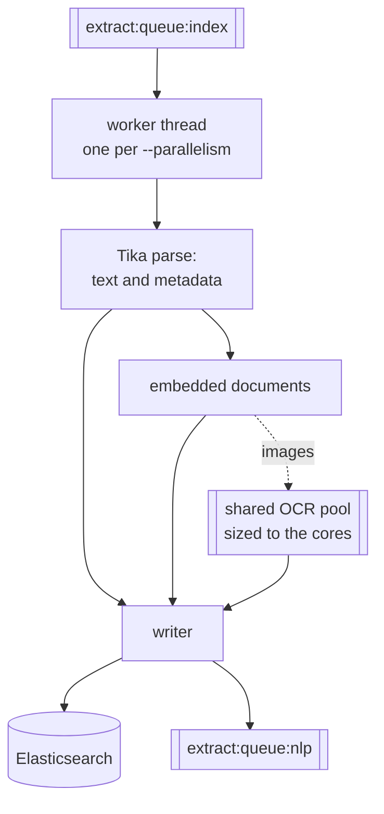

# INDEX

INDEX pops paths from its queue and, for each one, computes a content hash, extracts text and metadata with Apache Tika, OCRs images with Tesseract, descends into embedded documents, and writes the result to Elasticsearch.

```bash
datashare stage run \
  --stages INDEX \
  --dataDir /path/to/documents \
  --elasticsearchAddress http://elasticsearch:9200 \
  --reportName "report:my-project" \
  --queueType REDIS \
  --redisAddress redis://redis:6379
```

## Input and output

| | |
| --- | --- |
| Reads | `<queueName>:index`, and the files themselves from `--dataDir` |
| Writes | the Elasticsearch index named after `--defaultProject`, plus document ids to `<queueName>:<next stage>` |
| Distributable | **Yes.** The queue is a blocking list, so several machines pull different entries |

## Options that affect it

### Extraction

| Option | Default | Effect |
| ------ | ------- | ------ |
| `-o, --ocr` | `true` | Whether images are OCR'd at all. |
| `--ocrLanguage` | chosen per image | Tesseract languages, `eng+fra` for several. They must be installed on the machine. Left empty, each image is read with the language of its detected script when the `osd` and script models are installed, `eng` otherwise. A mapping such as `Cyrillic:rus+ukr,Han:chi_sim` keeps the per-image choice but reads the listed scripts with the given languages. |
| `--ocrRetryConfidence` | `60` | When the language is chosen per image, an image whose first read scores below this confidence (0 to 100) is read again with every script model. |
| `--ocrPageSegMode` | `AUTO` | Tesseract page segmentation mode. `AUTO` reads with mode 1, then 6 when the read is blank, then 11. An integer from 1 to 13 (except 2) forces that mode. |
| `--ocrMinConfidence` | `60` | OCR text with a confidence below this (0 to 100) is not used to detect the document's language. Only applies when the OCR records a confidence: the language is chosen per image, or `--ocrType` is `TESS4J`. |
| `--ocrStrategy` | `NO_OCR` | Whether PDF **pages** are rendered and OCR'd. `AUTO` for scanned PDFs. |
| `--ocrType` | `TESSERACT` | OCR engine. |
| `--ocrTimeout` | `12h` | Limit for a single OCR run. |
| `--parseTimeout` | `24h` | Limit for one document **and its whole embedded tree**. `0` disables it, with a warning. |
| `--maxEmbedDepth` | `20` | How deep to descend into nested containers. `0` disables the guard. |
| `--maxContentLength` | `20000000` | Text kept per document. Accepts `20M`. Longer text is truncated, the document is still indexed. |
| `-l, --language` | detected | Forces the language instead of detecting it from the extracted text. |
| `--charset` | JVM default | Encoding used for extracted text and metadata. |

### Identity

| Option | Default | Effect |
| ------ | ------- | ------ |
| `--digestAlgorithm` | `SHA384` | Hash used to build document ids. |
| `--digestProjectName` | none | Mixes the project name into the hash, so the same file in two projects gets two ids. |

### Throughput and bookkeeping

| Option | Default | Effect |
| ------ | ------- | ------ |
| `--parallelism` | number of cores | Documents extracted concurrently. |
| `--reportName` | none | Enables the report map. Without it nothing is recorded and nothing is skipped on a rerun. |
| `--indexTimeout` | `30` | Minutes between `Consumer has not terminated yet` log lines while waiting for in-flight documents. |
| `--createIndex` | none | Creates an index with the given name before running. |
| `--artifacts` / `--artifactDir` | none | Also write embedded payloads to disk as the parse goes. INDEX only produces the `raw` type. |

Extract carries further knobs, for the OCR pool, the mailbox fan-out, the embedded-text buffers and the streaming writer. **None of them is exposed as a flag, and a settings file does not reach a stage run**, so their defaults are what you get. They are described as behaviour in [Tuning](../../server-mode/indexing/tuning.md).

## Choosing the OCR settings

OCR is where INDEX spends most of its time. Settle these questions in order before a large run.

### 1. Do you need OCR at all?

For born-digital files (PDFs exported from an editor, Office documents, emails without scanned attachments), run with `--ocr false`. Indexing gets several times faster and you lose nothing. For scans, photos or mail archives with image attachments, keep it on. For scanned PDFs, add `--ocrStrategy AUTO`, otherwise the text lands on the embedded page images instead of on the PDF. See [Tuning](../../server-mode/indexing/tuning.md#ocr).

### 2. Which language?

| Your corpus | Set | Why |
| ----------- | --- | --- |
| Known languages, for example French and German | `--ocrLanguage fra+deu` | Fastest and most precise. A language model is smaller and more accurate than a script model. |
| Unknown or mixed languages | nothing | Each image is read with the model of its detected script. |
| Known scripts, each with known languages | `--ocrLanguage "Cyrillic:rus+ukr,Han:chi_sim"` | Keeps the per-image detection, but reads each listed script with the languages you name. |
| Traditional Chinese | `--ocrLanguage chi_tra` | The per-image choice only uses Simplified Chinese. |

**A list applies to every image.** With `eng+fra+deu`, Tesseract tries the first language on each word and goes to the next ones only for the words it is unsure about. Put the main language first: a clean page costs about one model, a messy page approaches the cost of all of them.

**When `--ocrLanguage` is empty**, each image goes through these steps:

1. Tesseract detects the image's script.
2. Datashare reads the image with that script's model plus the Latin one: Latin, Han, Cyrillic, Arabic, Japanese or Korean. Any other script is read with all six models at once.
3. When the mean word confidence of that read is below `--ocrRetryConfidence` (default `60`), Datashare reads the image again with all six script models and keeps the better of the two reads.

This needs the `osd` model and the six script models in `tessdata/script/`. The Docker image ships them, and the Debian package links them when the script packages are installed (it recommends `tesseract-ocr-all`). Elsewhere, Datashare logs one warning naming the missing models and falls back to `eng` for every image.

In a mapping, the keys are the names Tesseract's script detection reports: `Latin`, `Han`, `Cyrillic`, `Arabic`, `Japanese`, and `Korean` (not `Hangul`). A script you leave out keeps its script model. The low-confidence retry still uses the six script models, so they stay required.

**The per-image choice has a cost.** A script model needs about 270 MB per Tesseract process, against roughly 30 to 110 MB for `eng`. On degraded scans the retry can cost 9 to 14 times the CPU of a single `eng` read. If your scans are poor and mostly in one script, name the languages, or lower `--ocrRetryConfidence`. `0` turns the retry off.

### 3. Images without a page layout

`--ocrPageSegMode` sets how Tesseract looks for text in an image. The default `AUTO` reads with mode 1, which looks for a page layout. Only when that read is blank does it try mode 6 (one block of text), then mode 11 (scattered text). Screenshots, chat captures and photos with text in bubbles are typically the images where mode 1 finds nothing.

Keep `AUTO` unless images come out with some text but clearly miss most of it. `AUTO` does not retry those, because the first read was not blank. Force `--ocrPageSegMode 6` or `11` for such a corpus. Each extra read has its own `--ocrTimeout`, so a blank image can take up to three timeouts in `AUTO`.

### 4. Language detection on OCR'd text

Garbled OCR text makes the language detector pick a random language. With `--ocrMinConfidence` (default `60`), text read with a lower confidence is left out of the guess. It only applies when the OCR records a confidence: when the language is chosen per image, or with `--ocrType TESS4J`. If you know the language of the corpus, `--language` skips detection altogether.

### Summary

| Corpus | Suggested flags |
| ------ | --------------- |
| Born-digital | `--ocr false` |
| Scans in one or two known languages | `--ocrStrategy AUTO --ocrLanguage fra+eng` |
| Languages unknown | `--ocrStrategy AUTO`, script models installed, defaults otherwise |
| Mostly Russian and Ukrainian, some Chinese | `--ocrLanguage "Cyrillic:rus+ukr,Han:chi_sim"` |
| Screenshots that come out half empty | `--ocrPageSegMode 11` |

## How one document flows through



## Execution details

* **One document per worker thread.** `--parallelism` threads each take one path and own it until it is written, including its whole embedded tree. A container is therefore a single work unit: ten mailboxes use ten threads, one mailbox uses one.
* **OCR of embedded images does not stay on that thread.** Eligible images found inside a container are handed to a shared OCR pool sized to the core count, so attachments OCR in parallel even though the container is walked serially. Loose images on disk are OCR'd inline by the worker that picked them up.
* **Document ids are content hashes**, so indexing the same file twice updates one document instead of creating two. Changing `--digestAlgorithm` or `--digestProjectName` mid-project produces a second set of ids for the same files.
* **Embedded documents become documents.** A mailbox, an archive, or an email with attachments produces one indexed document per item, linked to its parent, which is why file counts and document counts differ by orders of magnitude.
* **The index is created if it does not exist**, with Datashare's mappings.
* **It writes to the next stage's queue as it goes.** Every document written to Elasticsearch is also pushed as an id onto `<queueName>:<next stage>`. When `--stages` ends at INDEX, "next" falls back to NLP, so `extract:queue:nlp` fills up even when you are not running NLP. With Redis that list stays until something consumes it.
* **Language is detected from the extracted text** unless `--language` is set. Setting it saves time and avoids pathological detection on files that are not prose. OCR text read with a confidence below `--ocrMinConfidence` is left out of the guess.
* **Termination**: when SCAN is listed in the same command, INDEX keeps polling while SCAN runs. Alone, it stops on its first empty poll. It then waits for in-flight documents, logging every `--indexTimeout` minutes.

## The report map

`--reportName` is what makes a run resumable. With it, the outcome of every path is recorded, and on a later run:

* paths recorded as **success** are skipped;
* paths recorded as a **parse timeout** or a **fatal error** are also skipped, because retrying them would spend the same hours or crash the same way;
* every other failure (Elasticsearch briefly unavailable, an interrupted worker) is **retried**.

To force a retry of a terminal failure, use a fresh report name or delete its entry. The map lives wherever `--queueType` points, so pair it with `REDIS` to make it survive the process.

## Failure and restart

| Situation | What happens |
| --------- | ------------ |
| A file fails to parse | Recorded in the report map, the run continues |
| An embedded document fails | The embed is indexed with an error marker and no text, its parent is unaffected |
| OCR times out on a loose image | The file is not indexed, and it is retried on the next run |
| The parse exceeds `--parseTimeout` | Recorded as a **terminal** timeout, which later runs will **not** retry |
| The process is killed | Queued paths survive in Redis, completed paths are in the report map, the handful of documents in flight are in neither |
| A restart during a huge container | That file restarts from the beginning: the report map records whole files, not positions inside them |

## See also

* [Tuning and performance](../../server-mode/indexing/tuning.md) for parallelism, OCR threads and heap sizing.
* [Troubleshooting](../../server-mode/indexing/troubleshooting.md) for what the errors mean.
* [SCAN](scan.md) upstream, [NLP](nlp.md) and [ARTIFACT](artifact.md) downstream.
