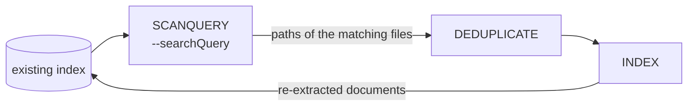

# SCANQUERY

SCANQUERY searches an existing Elasticsearch index and pushes the **file path** of every document the query matches onto the queue of the next stage. Combined with `INDEX`, it re-extracts only those files, with the extraction options of the current run. It is the opposite of [SCANIDX](scanidx.md), which marks paths so INDEX skips them.

A typical use is to run OCR again on documents with a language the first pass got wrong:

```bash
datashare stage run \
  --stages SCANQUERY,DEDUPLICATE,INDEX \
  --defaultProject my-project \
  --searchQuery "language:WELSH" \
  --ocrLanguage cym \
  --elasticsearchAddress http://elasticsearch:9200 \
  --queueType REDIS \
  --redisAddress redis://redis:6379
```

## Input and output

| | |
| --- | --- |
| Reads | the Elasticsearch index named after `--defaultProject` |
| Writes | the queue of the next stage, by default `extract:queue:deduplicate` or `extract:queue:index` |
| Distributable | **No.** It scrolls the query results from end to end; a second copy duplicates the work |

## Options that affect it

| Option | Default | Effect |
| ------ | ------- | ------ |
| `--searchQuery` | none, **required** | The documents to re-extract, as a Datashare query string or a JSON Elasticsearch clause. |
| `-P, --defaultProject` | `local-datashare` | The index to search. |
| `--reportName` | none | Leave it unset. When set, INDEX skips the paths already recorded as extracted, so the run may extract nothing. |
| `--scrollSize` | `1000` | Documents per scroll page. |
| `--scroll` | `60000ms` | Elasticsearch scroll duration. |
| `--queueName` | `extract:queue` | Prefix of the queue it writes to. Must match the INDEX run. |

## How it selects files



## Execution details

* **A query is mandatory.** Without `--searchQuery`, or with a blank one, the stage fails instead of re-extracting the whole index.
* **The next stage must read paths**, which means `DEDUPLICATE` or `INDEX`. Any other stage after it, such as `NLP`, is rejected.
* **It cannot run with `SCAN`.** Both feed INDEX with paths, so asking for both in the same `--stages` is rejected.
* **An embedded document queues its container.** The path of an attachment or an archive entry is the file on disk that holds it, so a container with several matching embedded documents is queued once per match. Add `DEDUPLICATE` to extract it only once; the stage logs a warning when it is missing.
* **It only queues paths.** It does not touch the report map, nor the documents themselves: the re-extraction is done by INDEX, which updates the existing documents rather than duplicating them.

## Failure and restart

SCANQUERY only reads the index, so re-running it is safe. If it is interrupted, run it again: files already re-extracted are extracted a second time, which costs time and nothing else.

## See also

* [SCANIDX](scanidx.md), which does the opposite: marks indexed paths so INDEX skips them.
* [ENQUEUEIDX](enqueueidx.md), which selects documents with a query too, but queues document ids for the stages after INDEX.
* [DEDUPLICATE](deduplicate.md), to extract each container once.
