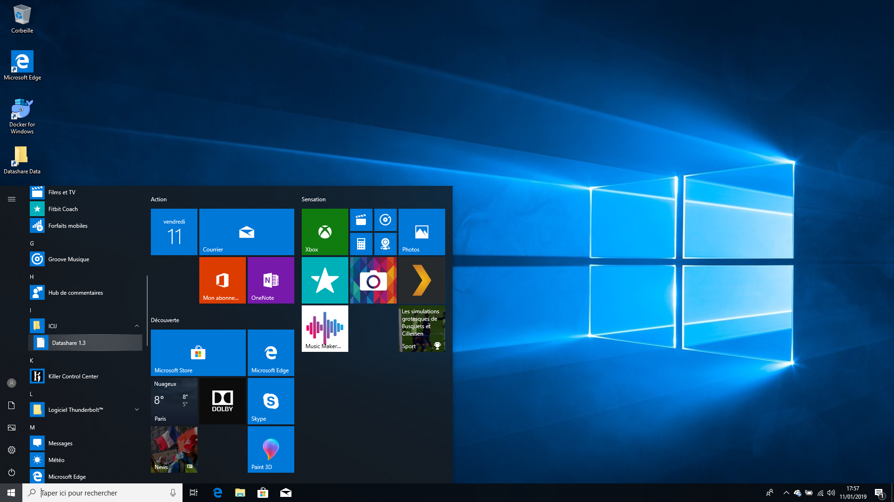
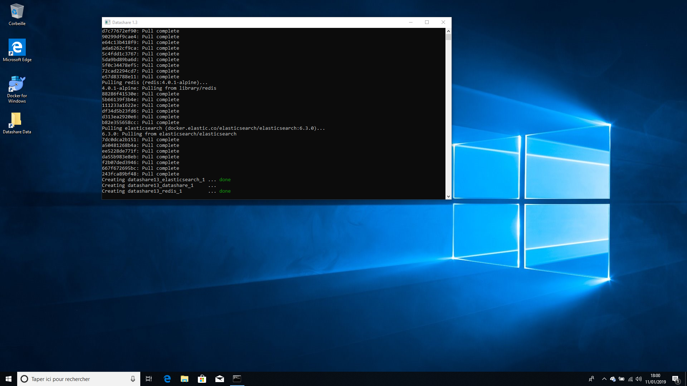
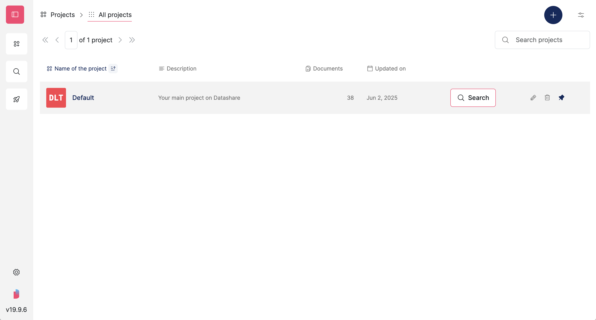

# Start Datashare

Open the Windows main menu at the left of the bar at the bottom of your computer screen and click on '**Datashare'**. (The numbers after 'Datashare' just indicate which version of Datashare you installed.)

<figure> &#x27;Datashare 1.3&#x27; highlighted"><figcaption></figcaption></figure>

A window called 'Terminal' will have opened, showing the progress of opening Datashare. **Do not close this black window as long as you use Datashare**.

<figure><figcaption></figcaption></figure>

**Keep this Terminal window open as long as you use Datashare.**

**Datashare should now automatically open in your default internet browser.**\
If it doesn’t, type '[localhost:8080](http://localhost:8080)' in your browser.

Datashare **must be accessed from your internet browser** (Firefox, Chome, etc), even though it works offline without Internet connection (see FAQ: [Can I use Datashare with no internet connection?](../../usage/faq/general/can-i-use-datashare-with-no-internet-connection.md)).

<figure><figcaption>
Datashare's homepage
</figcaption></figure>


**Advanced: adjusting memory settings**

If Datashare crashes on startup or during use, it may be due to insufficient memory allocated to Datashare or Elasticsearch. Two variables control it:

| Variable | Controls | Recommended value |
|---|---|---|
| `DS_JAVA_OPTS` | Memory allocated to Datashare | `-Xmx2g` |
| `ES_JAVA_OPTS` | Memory allocated to Elasticsearch | `-Xms2g -Xmx2g` |

Adjust these values to the memory available on your computer. You can set them in two ways:

* **In the `datashare.bat` script:** open `datashare.bat` in the installation folder (usually `C:\Program Files\Datashare`) with a text editor as administrator, and remove the `::` in front of the two `set` lines in the 'Memory settings' section. Your changes are lost when you update Datashare.
* **In the Windows environment variables:** search for 'environment variables' in the Windows main menu, open 'Edit environment variables for your account', and add each variable under 'User variables'. Your settings are kept when you update Datashare. Restart Datashare to apply them.

See [Performance considerations](../../server-mode/performance-considerations.md) for more recommendations.


You can now [add documents to Datashare](add-documents-to-datashare-on-windows.md).
