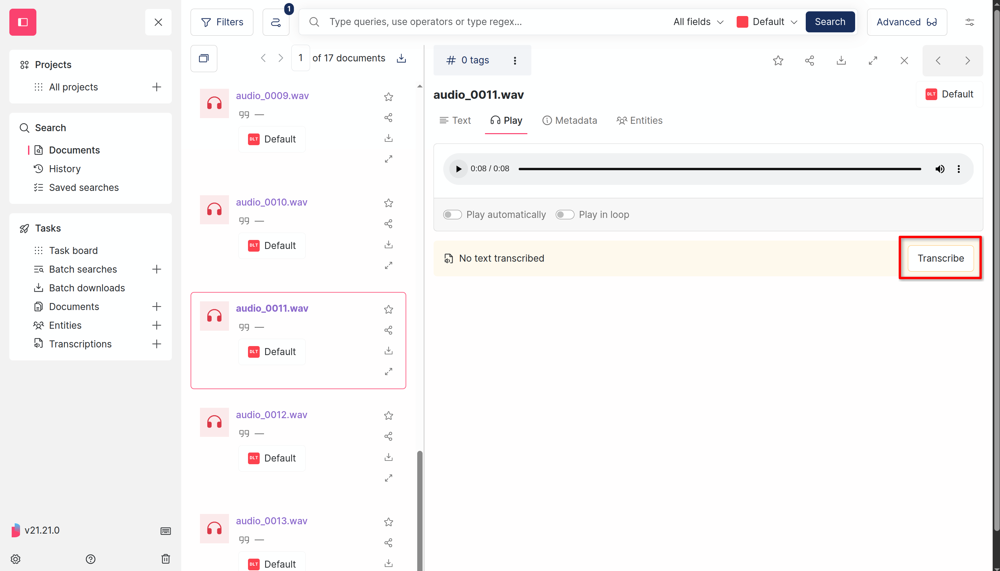
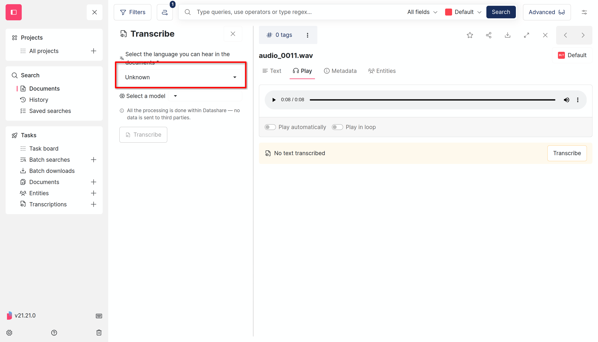
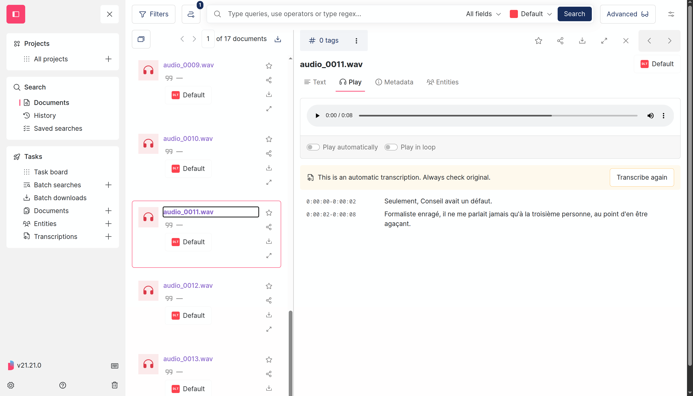
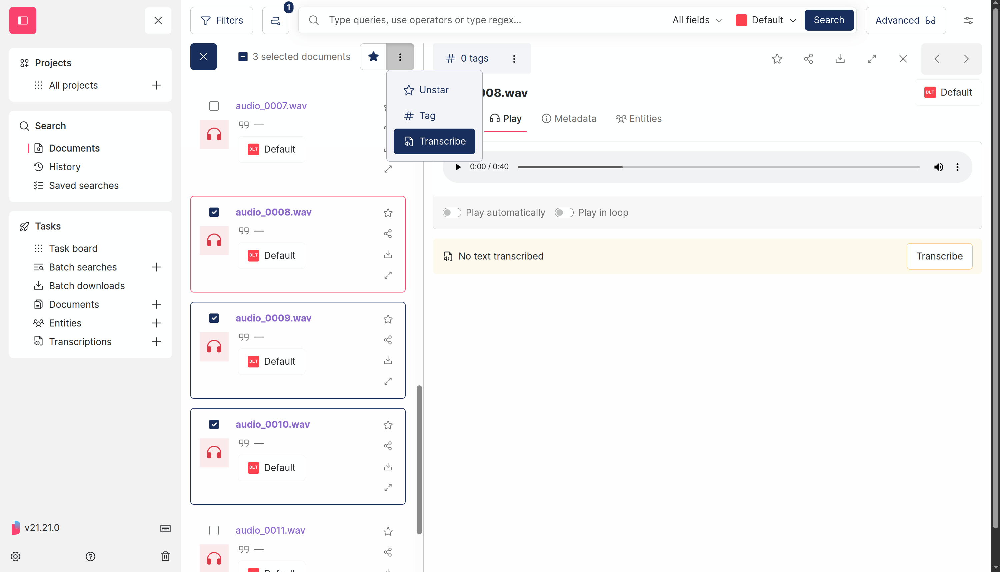
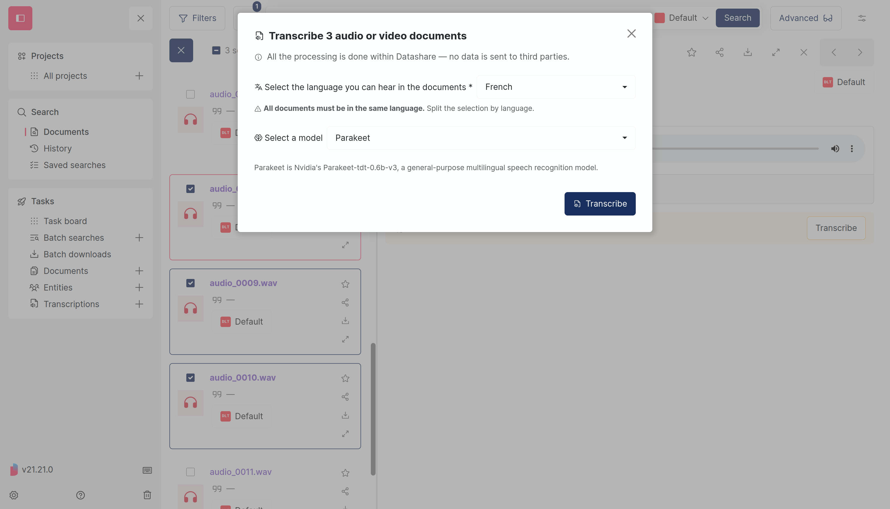
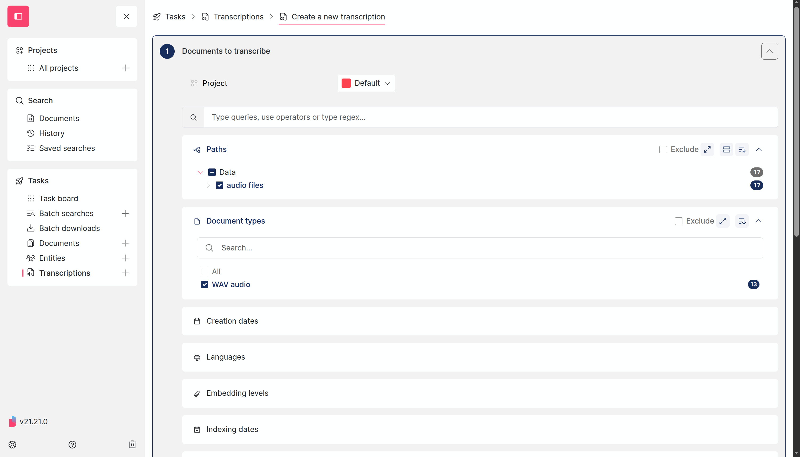
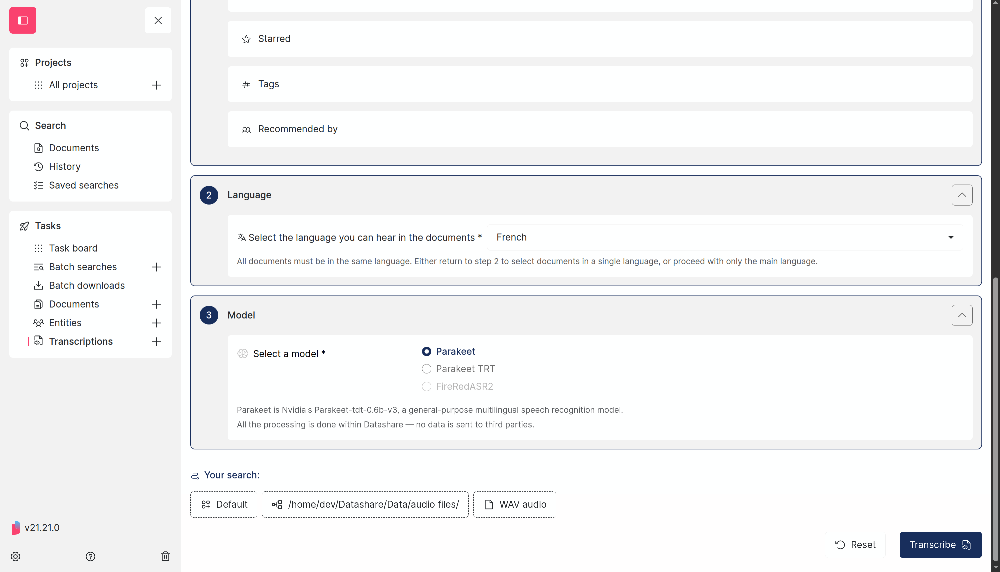
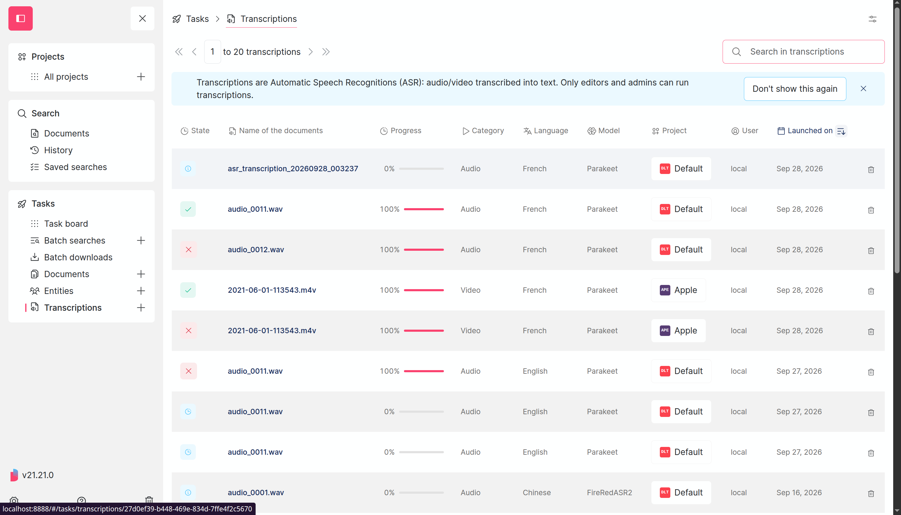

# Transcribe documents

## Transcribe documents

### Transcribe a single document

1. Open an audio or video document in Datashare. Below the media player, click the **Transcribe** button.

<figure><figcaption>
The Transcribe button appears below the media player
</figcaption></figure>

2. Select the **language** spoken in the document and a **model**.

<figure><figcaption>
Select the language and model, then click Transcribe
</figcaption></figure>

3. Click **Transcribe**. Once complete, the transcription appears below the media player with timestamps.

<figure><figcaption>
The transcription result with timestamps
</figcaption></figure>

You can **download** the transcription as a text file, **download with timestamps**, or **transcribe again** with a different model or language.

### Transcribe from search results

You can transcribe several documents at once directly from the search results:

1. Search for documents and select them using the checkboxes.
2. Click the **three dots** menu in the selection toolbar and choose **Transcribe**.

<figure><figcaption>
Select documents and click Transcribe from the toolbar menu
</figcaption></figure>

3. Choose the language and model in the dialog, then click **Transcribe**.

<figure><figcaption>
Choose language and model for the selected documents
</figcaption></figure>


All documents in a batch transcription must be in the **same language**. If your documents contain multiple languages, create separate transcription tasks for each language.


### Transcribe via the form

For more control over document selection, use the transcription form:

1. In the sidebar, click **Transcriptions** then **New transcription**.
2. **Step 1 — Documents**: Select the documents to transcribe using filters (project, path, content type, language, etc.).

<figure><figcaption>
Filter documents by project, path and content type
</figcaption></figure>

3. **Step 2 — Language**: Select the language spoken in the documents.
4. **Step 3 — Model**: Select the speech recognition model to use.
5. Review the selection summary and click **Transcribe**.

<figure><figcaption>
Select language, model and review the search summary
</figcaption></figure>

### Available models

| Model        | Languages                                    | Description                                                                  |
| ------------ | -------------------------------------------- | ---------------------------------------------------------------------------- |
| Parakeet     | 25+ languages (EN, FR, DE, ES, IT, PT, etc.) | General-purpose multilingual model. Good balance between speed and accuracy. |
| Parakeet TRT | Same as Parakeet                             | TensorRT-optimized version. Faster on compatible NVIDIA GPUs.                |
| FireRedASR2  | Chinese (ZH)                                 | Specialized for Chinese language transcription.                              |


The model selector automatically disables models that don't support the selected language. For example, FireRedASR2 is only available when Chinese is selected.


### View transcription results

#### Transcriptions page

In the sidebar, click **Transcriptions** to access the list of all transcription tasks. Each task shows its state, progress, language, model, project, user and launch date.

<figure><figcaption>
The transcriptions list with all tasks and their status
</figcaption></figure>

Click on a task to see its details, including individual document statuses for batch transcriptions.

#### Document viewer

Once a document has been transcribed, open it in Datashare. The transcription text will appear below the media player. You can:

* **Read** the transcription alongside the audio/video
* **Download** the transcription as a text file
* **Download with timestamps** for a timestamped version
* **Transcribe again** with a different model or language

### Unsupported formats

Documents whose content type is not audio or video (such as PDFs, images, or text files) will not be transcribed. When creating a batch transcription, the selection summary will display a warning indicating how many documents will be skipped due to unsupported formats.
