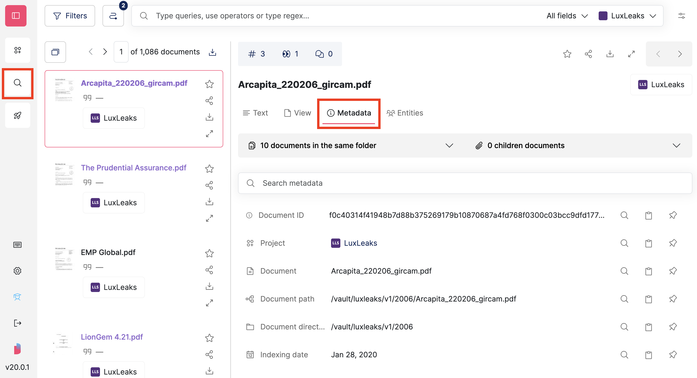
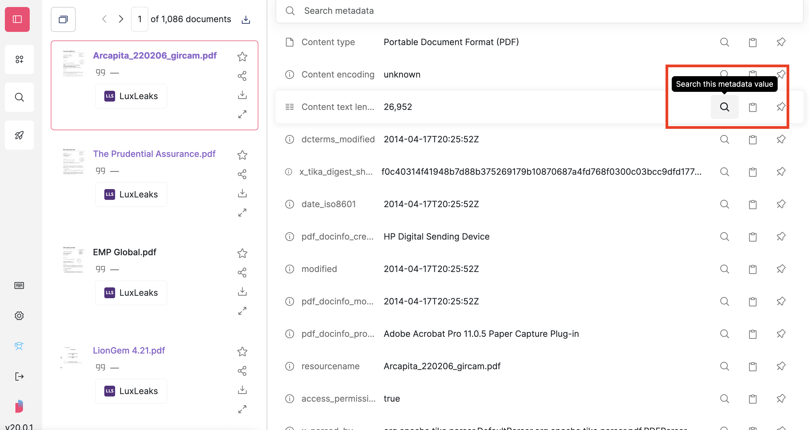
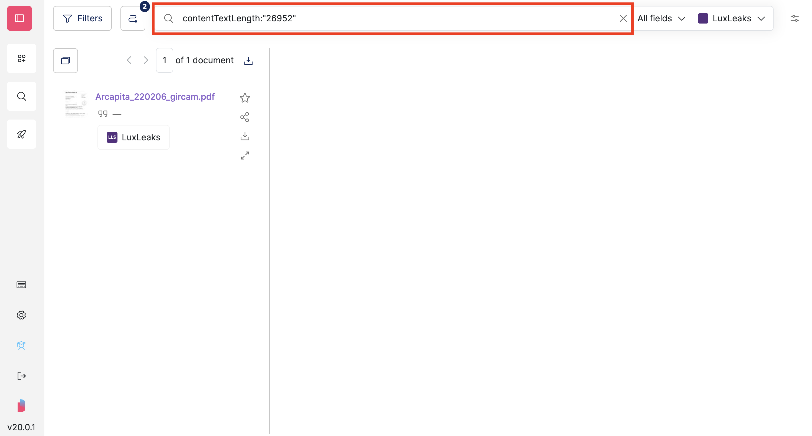

# Search with operators or Regex

### Double quotes for e**xact phrase**

To have all documents mentioning an exact phrase, you can use double quotes. **Use straight double quotes ("example"), not curly double quotes (“example”).**

> "Alicia Martinez’s bank account in Portugal"

### **OR (or space)**

To have all documents mentioning at least one of the queried terms, you can use a simple space between your queries (as OR is the default operator in Datashare) or <kbd>OR</kbd> . You need to write <kbd>OR</kbd> with **all letters uppercase**.

> Alicia Martinez
>
> Alicia OR Martinez

### **AND (or +)**

To have all documents mentioning all the queried terms, you can use <kbd>AND</kbd> between your queried words. You need to write <kbd>AND</kbd> with **all letters uppercase**.

> Alicia AND Martinez
>
> +Alicia +Martinez

### **NOT (or ! or -)**

To have all documents <kbd>NOT</kbd> mentioning some queried terms, you can use <kbd>NOT</kbd> before each word you don't want. You need to write <kbd>NOT</kbd> with **all letters uppercase**.

> NOT Martinez
>
> !Martinez
>
> -Martinez

### **Combine operators**

Parentheses should be used whenever multiple operators are used together and you want to give priority to some.

> ((Alicia AND Martinez) OR (Delaware AND Pekin) OR Grey) AND NOT "parking lot"

You can also combine these with regular expressions (regex) between two slashes ([see below](search-with-operators.md#regular-expressions-regex)).

### **Wildcards**

If you search faithf<kbd>?</kbd>l, the search engine will look for all words with all possible single character between the second f and the l in this word. It also works with <kbd>\*</kbd> to replace multiple characters.

> Alicia Martin?z
>
> Alicia Mar\*z

### **Fuzziness**

You can set fuzziness to 1 or 2. It corresponds to the maximum number of operations (insertions, deletions, substitutions and transpositions) on **characters** needed to make one **term** match the other.

> kitten -> sitten (1 substitution (k turned into s) = fuzziness is 1)

> kitten -> sittin (2 substitutions (k turned into s and e turned into i) = fuzziness is 2)

If you search for similar terms (**to catch typos for example**), you can use fuzziness. Use the [tilde symbol](https://en.wikipedia.org/wiki/Tilde) at the end of the word to set the fuzziness to 1 or 2.

"_The default edit distance is 2, but an edit distance of 1 should be sufficient to catch 80% of all human misspellings. It can be specified as: quikc\~1_" (source: [Elastic](https://www.elastic.co/guide/en/elasticsearch/reference/7.0/query-dsl-query-string-query.html#_fuzziness)).

> quikc\~ brwn\~ foks\~ (as the default edit distance is 2, this query will catch all quick, quack, quock, uqikc, etc. as well as brown, folks, etc.)
>
> Datashare\~1 (this query will catch Datasahre, Dqtashare, etc.)

### **Proximity searches**

When you type an exact phrase (in double quotes) and use fuzziness, then the meaning of the fuzziness changes. Now, the fuzziness means the maximum number of operations (insertions, deletions, substitutions and transpositions) on **terms** needed to make one **phrase** match the other.

Examples:

> "the cat is blue" -> "the small cat is blue" (1 insertion = fuzziness is 1)

> "the cat is blue" -> "the small is cat blue" (1 insertion + 2 transpositions = fuzziness is 3)

"_While a phrase query (eg "john smith") expects all of the terms in exactly the same order, a proximity query allows the specified words to be further apart or in a different order. A proximity search allows us to specify a maximum edit distance of words in a phrase._" (source: [Elastic](https://www.elastic.co/guide/en/elasticsearch/reference/7.0/query-dsl-query-string-query.html#_fuzziness)).

> "fox quick"\~5 (this query will catch "quick brown fox", "quick brown car thin fox" or even "quick brown car thin blue tree fox"

The closer the text in a field is to the original order specified in the query string, the more relevant that document is considered to be. When compared to the above example query, the phrase `quick fox` would be considered more relevant than `quick brown fox`(source: [Elastic](https://www.elastic.co/guide/en/elasticsearch/reference/7.0/query-dsl-query-string-query.html#_fuzziness)).

### **Boosting operators**

Use the _boost_ operator <kbd>^</kbd> to make one term more relevant than another. For instance, if we want to find all documents about foxes, but we are especially interested in quick foxes:

> quick^2 fox

The default boost value is 1, but can be any positive floating point number. Boosts between 0 and 1 reduce relevance. Boosts can also be applied to phrases or to groups:

> "john smith"^2 (foo bar)^4

(source: [Elastic](https://www.elastic.co/guide/en/elasticsearch/reference/7.0/query-dsl-query-string-query.html#_fuzziness))

### **Regular expressions (Regex)**

‌"_A regular expression (shortened as regex or regexp) is a sequence of characters that define a search pattern._" ([Wikipedia](https://en.wikipedia.org/wiki/Regular_expression)).

1\. You can use Regex in Datashare. Regular expressions (Regex) in Datashare need to be **written between 2 slashes** and **start with the name of the field** to search in:

> content:/dimitr\[iyu]/

2\. Regex can be combined with standard queries in Datashare:

> ("Ada Lovelace" OR "Ado Lavelace") AND paris AND content:/.\*\\.com/

3\. **You need to escape the following characters by typing a backslash just before them (without space):‌ . ? + \* | { } \[ ] ( ) " \ # @ & < > \~**

> content:/.\*\\@.\*/ (the @ was escaped by a backslash \ just before it)

Without the backslash, some of these characters have a special meaning. For instance, an unescaped @ means "any text", so <kbd>content:/.\*@.\*/</kbd> finds **all** documents.

4\. Important: **Datashare relies on Elastic's Regex syntax** as explained[ here](https://www.elastic.co/guide/en/elasticsearch/reference/current/regexp-syntax.html). How a Regex behaves depends on the field you search in.

#### Regex in the content of documents

Datashare uses [the Standard tokenizer](https://www.elastic.co/guide/en/elasticsearch/reference/current/analysis-standard-tokenizer.html) to split the content of documents into **words**. This has three consequences:

* **A Regex matches one word at a time**, never a whole sentence. Spaces, and most punctuation such as - , / or @, split words, so they **cannot be searched in a Regex**. For instance, 'first.lastname@email.com' is stored as two words: 'first.lastname' and 'email.com'.
* **The content is stored in lowercase**, so **write your Regex in lowercase**. <kbd>content:/.\*gmbh.\*/</kbd> finds GmbH, GMBH and gmbh, while <kbd>content:/.\*GmbH.\*/</kbd> finds nothing.
* **Accents are removed**, so <kbd>content:/cafe/</kbd> also finds 'café'.

We encourage you to **use the&#x20;**<kbd>**AND**</kbd>**&#x20;operator** to work around this limitation and make sure you can make your search.

If you're looking for French International Bank Account Number (IBAN) that can or cannot contain space and contain FR followed by numbers and/or letters (it could be FR7630001007941234567890185 ou FR76 3000 4000 0312 3456 7890 H43 for example), you can then search for:

> content:/fr\[0-9]{14}\[0-9a-z]{11}/ OR (content:/fr\[0-9]{2}/ AND content:/\[0-9]{4}/)

Here are a few examples of useful Regex:

* You can search for <kbd>**content:/dimitr\[iyu]/**</kbd> instead of searching for **Dimitri OR Dimitry OR Dimitru**. It will find all the Dimitri, Dimitry or Dimitru.
* You can search for <kbd>**content:/dimitr\[^yu]/**</kbd> if you want to search all the words which begin with Dimitr and **do not end with either y nor u.**
* You can search for <kbd>**content:/dimitri<1-5>/**</kbd> if you want to search **Dimitri1, Dimitri2, Dimitri3, Dimitri4 or Dimitri5**.

Other common Regex examples:

* phone numbers written without spaces or dashes, like 8989829304: `content:/[0-9]{10,12}/`. A number written with dashes, like 786-307-3615, is stored as three words, so search it with `content:786 AND content:307 AND content:3615`.
* email domains, like 'email.com' in 'first.lastname@email.com': `content:/.*\.(com|org|net)/`
* credit cards: `content:/(4[0-9]{12}([0-9]{3})?|[25][1-7][0-9]{14}|6(011|5[0-9][0-9])[0-9]{12}|3[47][0-9]{13}|3(0[0-5]|[68][0-9])[0-9]{11}|(2131|1800|35[0-9]{3})[0-9]{11})/`

#### Regex in other fields

Fields such as the path, the file type or the tags store each value as a whole, without splitting it into words or changing its case. On these fields, **a Regex must match the whole value** and **is case sensitive**.

For instance, to exclude all the files whose path ends with '.json', whatever the case:

> -path:/.\*\\.\[jJ]\[sS]\[oO]\[nN]/

To exclude all JSON files based on their file type, you don't need a Regex:

> -contentType:"application/json"

Here are some fields you can search in:

* <kbd>content</kbd>: the text of the document
* <kbd>path</kbd>: the full path of the file
* <kbd>metadata.tika\_metadata\_resourcename</kbd>: the name of the file
* <kbd>contentType</kbd>: the file type, like application/pdf
* <kbd>language</kbd>: the language of the document, like ENGLISH
* <kbd>tags</kbd>: the tags of the document
* <kbd>extractionLevel</kbd>: 0 for the files in your folders, 1 or more for attachments and files inside archives

To find the name of other fields, see [Search with metadata fields](search-with-operators.md#search-with-metadata-fields) below. The 'Author' and 'Recipients' choices in the field dropdown of the search bar are not field names: they search in several fields at once and can't be typed in a query.

You can find many other examples [on this site](https://ihateregex.io/). More generally, if you use a regex found on internet, beware that the syntax is not necessarily compatible with elasticsearch's. For example `\d`, `\S`, `(?:` and the like [are not understood](https://www.elastic.co/guide/en/elasticsearch/reference/current/regexp-syntax.html). Searching with a Regex that starts with `.*` can be slow on large projects.

### **Search with metadata fields**



In '**Search**' > '**Documents**', open a **document** and go to the '**Metadata**' tab:

<figure><figcaption></figcaption></figure>



Click a metadata's **search** **icon** to search documents with same properties:

<figure><figcaption></figcaption></figure>



See the **query** in the main search bar. It contains the field name, two dots and the searched value:

<figure><figcaption></figcaption></figure>

So for example, if you are looking for documents that:

* Contains term1, term2 and term3
* And were created after 2010

you can use the 'Date' filter or type in the search bar:

> term1 AND term2 AND term3 AND metadata.tika\_metadata\_creation\_date:>=2010-01-01

Explanations:

* 'metadata.tika\_metadata\_creation\_date:' means that we filter with creation date
* '>="'means 'since January 1st included'
* '2010-01-01' stands for January 2010 and the search will include January 2010

For other searches:

* '<' will mean 'strictly before (with January 1st excluded)'
* no character will mean 'at this exact date'

**Ranges**: You can also search for numbers in a range. Ranges can be specified for **date**, **numeric** or **string fields** among the ones you can find by clicking the magnifying glass when you hover the fields in a document's tab 'Metadata'. Inclusive ranges are specified with square brackets \[min TO max] and exclusive ranges with curly brackets {min TO max}. For more details, please refer to [Elastic's page on ranges](https://www.elastic.co/guide/en/elasticsearch/reference/current/query-dsl-query-string-query.html#_ranges).



### **Search in translated content only**


Your documents must have been translated in Datashare before.&#x20;


By default, **Datashare searches in both original and translated content**. Here is how to search in translated content only:

#### Search a term

**Type&#x20;**<kbd>**content\_translated.content:**</kbd> followed by your term in the search bar.

For instance, Datashare finds documents whose **translated content contains 'paris'** here:

<kbd>content\_translated.content:paris</kbd>

You don't need quotes to search a single term.

#### Search an exact phrase

To search for **several terms side by side and in this order**, put them **between double quotes**.

For instance, Datashare finds documents whose translated content contains the **exact phrase 'paris is in france'** here:

<kbd>content\_translated.content:"paris is in france"</kbd>

#### Search several terms in any order

If you type several terms **without quotes or parentheses**, only the **first term** is searched in the translated content. The other terms are searched in both original and translated content.

For instance, here Datashare searches 'paris' in the translated content, but 'france' in all fields:

<kbd>content\_translated.content:paris france</kbd>

To search **all terms in the translated content, in any order**, put them **between parentheses**. As the **default operator is OR**, Datashare finds documents whose translated content contains **either 'paris' or 'mercedes' or both terms** here:

<kbd>content\_translated.content:(paris France)</kbd>

Note that you can change the default operator and pick AND instead in the [result settings](https://icij.gitbook.io/datashare/usage/search-documents#results-settings).

Or find only documents whose translated content contains **both terms**, add **AND** between them:

<kbd>content\_translated.content:(paris AND mercedes)</kbd>

#### Use wildcards and fuzziness

Without quotes, you can also use **wildcards** and **fuzziness** in the translated content.

For instance, Datashare finds documents whose translated content contains terms **starting with 'mercede' plus a single character**, such as 'mercedes', here:

<kbd>content\_translated.content:mercede?</kbd>

Datashare finds documents whose translated content contains terms **starting with 'merc'** plus **multiple characters**, such as 'mercedes':

<kbd>content\_translated.content:merc\*</kbd>

And documents whose translated content contains terms **close to 'mercedes'**, such as 'mercedez', here:

<kbd>content\_translated.content:mercedes\~</kbd>

Note that wildcards (\* or ?) and fuzziness (\~) don't work inside double quotes.

#### Search in original content only (not translated)&#x20;

Simply select 'Content' in the field dropdown at the right inside the search bar, here:

<figure><figcaption></figcaption></figure>

